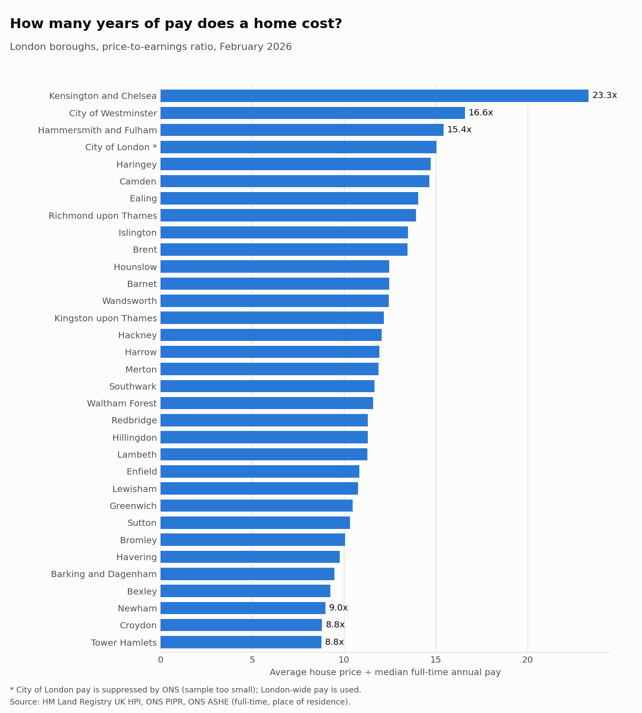
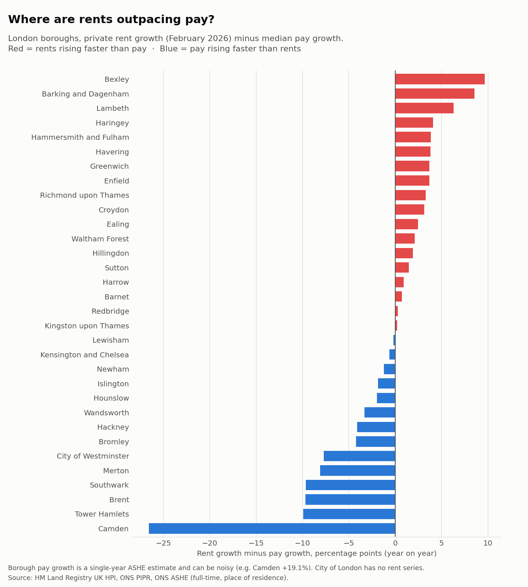
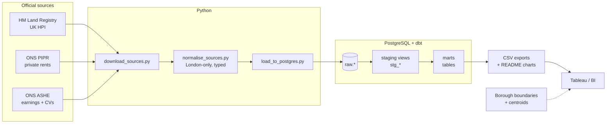

# London Housing Affordability & Rental Pressure Analytics

[](https://github.com/aosman101/london-housing-analytics/actions/workflows/ci.yml)


An end-to-end analytics pipeline that turns official HM Land Registry and ONS releases into
borough-level affordability metrics for all 33 London local authorities. Python handles
download and normalisation, PostgreSQL stores the data, dbt builds and tests the models, and
the marts are exported for BI tools such as Tableau.

## Key findings (February 2026)



- **A home costs between 8.8x and 23.3x local pay.** Kensington and Chelsea is the outlier at
  23.3x median full-time pay, followed by Westminster (16.6x) and Hammersmith and Fulham
  (15.4x). Tower Hamlets, Croydon and Newham are the most affordable, at about 9x. The
  median borough sits at 11.9x.
- **A 10% deposit costs between 10.5 and 28 months of gross pay**, depending on the borough,
  before any rent or living costs.
- **Rent takes 39–83% of median full-time gross pay.** Kensington and Chelsea (83%) and
  Westminster (72%) are the extremes.



- **Rents are outpacing pay in 18 of 32 boroughs.** The pressure is sharpest in outer east
  London: Bexley (+9.7pp) and Barking and Dagenham (+8.6pp). Rents in several prime inner
  boroughs are falling year on year.
- **Property type is as big a driver as location.** Across boroughs, the median flat costs 8.4x
  local pay, a terraced house 13.3x and a detached house 26.7x.

> These are trend indicators, not precise point estimates. See [Methodology & limitations](#methodology--limitations).

## Business questions

1. Which London boroughs are least affordable when house prices are compared with resident earnings?
2. Where is rental pressure rising faster than local income growth?
3. How do borough-level sales volumes and price growth move together over time?
4. Which boroughs show the biggest affordability gap by property type?
5. How far does a typical 10% deposit sit from local annual earnings?

## Architecture



## Engineering highlights

- **Config-driven vintages.** Release months and URLs are templated from
  [`config/sources.yml`](config/sources.yml), so picking up a new HPI/PIPR/ASHE release is a
  config change, not a code change.
- **Defensive parsing.** The HPI property-type parser handles both long and grouped-wide
  layouts, and works out which column group is "All property types" by comparing it with the
  headline series. ASHE workbooks are found by pattern, so next year's file works unchanged.
- **Statistical quality carried through.** ASHE coefficients of variation are mapped to the
  ONS precision bands (`Precise` → `Unreliable`) and exposed as `earnings_quality` on every
  mart row. Where ONS suppresses a borough estimate (City of London), the London-wide figure
  is used and flagged with `earnings_fallback_used`.
- **No era-mixing.** A reusable dbt macro (`earnings_lookup`) attaches earnings only to months
  within one year of the ASHE reference year, so historical prices are never divided by
  present-day pay. A dbt test enforces this.
- **Tested at two levels.** Python unit tests cover parsing helpers. 41 dbt tests cover
  uniqueness, not-null, accepted values, value ranges and business rules, and source
  freshness thresholds reflect each publisher's release lag.
- **CI on real Postgres.** GitHub Actions lints and unit-tests the Python, then loads
  [fixture extracts](tests/fixtures/normalised) into a Postgres 16 service container and runs
  `dbt build`, so every model and test runs on each push without downloading source data.
- **Safe reloads.** The loader refuses to replace raw tables unless every normalised input is
  present, and downloads are written atomically through `.part` files.

## Data model

| Layer | Objects |
| --- | --- |
| Raw files | `data/raw/*` (downloaded, vintage-stamped) |
| Normalised files | `data/normalised/*` (London-only, typed CSVs) |
| PostgreSQL raw schema | `raw.hpi_average_prices`, `raw.hpi_property_type_prices`, `raw.hpi_sales`, `raw.pipr_local_rents`, `raw.ashe_earnings` |
| dbt staging (views) | `stg_hpi_average_prices`, `stg_hpi_property_type_prices`, `stg_hpi_sales`, `stg_pipr_local_rents`, `stg_ashe_earnings` |
| dbt marts (tables) | `mart_london_affordability_monthly`, `mart_london_borough_snapshot_latest`, `mart_london_property_type_latest` |

| Mart | Grain | Use |
| --- | --- | --- |
| `mart_london_affordability_monthly` | borough × month (1995 → latest) | Price, rent and sales trends; affordability ratios for months with earnings coverage |
| `mart_london_borough_snapshot_latest` | borough | Latest-month map/ranking view, with latest published sales volume and ranks |
| `mart_london_property_type_latest` | borough × property type | Affordability gap by detached / semi / terraced / flat |

Run `make dbt-docs` to browse the full column documentation and lineage graph.

## KPI definitions

| KPI | Definition |
| --- | --- |
| `average_price` | HPI average residential price (3-month moving average at borough level) |
| `avg_monthly_rent` | PIPR average monthly private rent |
| `median_gross_annual_pay` | ASHE median gross annual pay, full-time employees, by place of residence |
| `price_to_earnings_ratio` | `average_price / median_gross_annual_pay` |
| `annual_rent_to_earnings_ratio` | `(avg_monthly_rent * 12) / median_gross_annual_pay` |
| `months_to_save_10pct_deposit` | `(average_price * 0.10) / (median_gross_annual_pay / 12)` |
| `rent_growth_minus_income_growth_pct` | `rent_yoy_pct - earnings_yoy_pct` (percentage points; positive = rents outpacing pay) |
| `house_price_growth_minus_income_growth_pct` | `house_price_yoy_pct - earnings_yoy_pct` |
| `earnings_quality` | ONS precision band from the ASHE coefficient of variation |
| `earnings_fallback_used` | `true` when the borough estimate is suppressed and London-wide pay is used |

## Data sources

- HM Land Registry UK House Price Index: average prices, sales volumes, prices by property type.
- ONS Price Index of Private Rents (PIPR): monthly price statistics.
- ONS Annual Survey of Hours and Earnings (ASHE), Table 8 (place of residence): 8.7a annual gross pay and 8.7b CVs.
- ONS Open Geography Portal: London borough boundaries (from LAD May 2024 BGC) and centroids in [`data/spatial`](data/spatial), for mapping in BI tools.

Contains HM Land Registry data © Crown copyright and database right 2026. Contains Office for
National Statistics data licensed under the [Open Government Licence v3.0](https://www.nationalarchives.gov.uk/doc/open-government-licence/version/3/).

## How to run locally

Requires Python 3.12 and Docker.

```bash
python3.12 -m venv .venv && source .venv/bin/activate
make install
cp .env.example .env      # Postgres credentials, shared by Docker, Python and dbt
make up                   # starts Postgres and waits until it is healthy
make all                  # lint + tests + download + normalise + load + dbt build + export + charts
```

dbt reads its connection from [`dbt/profiles.yml`](dbt/profiles.yml) using the same `PG*`
environment variables, so no `~/.dbt` setup is needed. Individual steps: `make download`,
`make normalise`, `make load`, `make dbt-build`, `make dbt-docs` (lineage on
http://localhost:8080), `make export`, `make charts`. Run `make help` for the full list.

```
config/            source vintages and URL templates
src/extract/       downloads
src/transform/     London-only normalisation (HPI, PIPR, ASHE + CVs)
src/load/          Postgres load and mart export
src/report/        README chart rendering
dbt/               staging + mart models, tests, earnings_lookup macro
tests/             unit tests and CI fixture extracts
data/spatial/      borough boundaries (GeoJSON) and centroids for mapping
```

## Methodology & limitations

- **Earnings coverage.** Only the latest ASHE release (2025 provisional) is loaded, so
  earnings-based ratios cover 2025 onward. Earlier months keep prices, rents and sales, but
  their ratio columns are null by design.
- **Borough pay growth is noisy.** Single-year changes in borough-level ASHE medians carry
  sampling error. For example, Camden's +19.1% (CV 9.4%) produces its −26.6pp rental-pressure
  reading. Use `earnings_quality` and treat growth gaps as indicative.
- **Workplace vs residence.** Earnings are by place of residence (what residents earn, wherever
  they work), which is the right lens for local housing affordability.
- **HPI smoothing.** Borough-level HPI is a 3-month moving average, and sales volumes omit the
  most recent ~2 months, so the snapshot reports the latest *published* sales month separately.
- **City of London.** Very few transactions make it volatile, PIPR publishes no rent series for
  it, and its ASHE estimate is suppressed (London-wide pay is used instead).
- **PIPR** is an official statistic in development, and its latest two months are subject to revision.

## Roadmap

- Load multiple ASHE years to build a genuine decade-long price-to-earnings time series.
- Add cross-source reconciliation tests, such as borough coverage parity between HPI and PIPR.
- Extend beyond London: the pipeline is already keyed on ONS area codes.

## License

Code is released under the [MIT License](LICENSE). Data remains subject to the source licences above.
