# Housing Analytics: London Affordability Dashboard

An interactive, Power BI-style dashboard plus 20 publication-ready visuals covering all
33 London boroughs. It is built from the pipeline's normalised HM Land Registry and ONS
data and answers the project's five business questions, plus market, investor and risk
analysis.

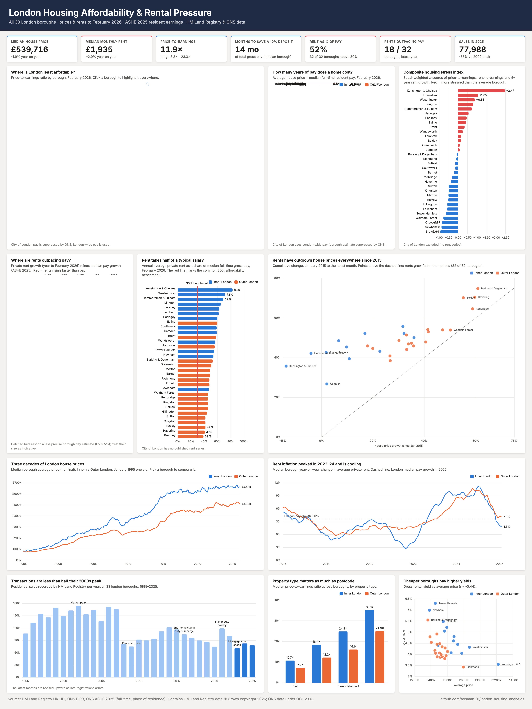

## What's in this folder

| Path | What it is |
| --- | --- |
| [`dashboard/index.html`](dashboard/index.html) | Interactive dashboard: 8 report pages, Inner/Outer London slicer, borough highlight and drill-down, map metric switcher, hover tooltips. Open it in any browser; it works offline. |
| [`images/`](images) | PNG exports: the full dashboard, 19 single visuals and 3 app-page screenshots (2× resolution, ready to post). |
| [`tables/`](tables) | The numbers behind every visual as CSV, for Excel, Tableau or Power BI. |
| [`key_metrics.json`](key_metrics.json) | Headline figures quoted below. |
| [`build_analytics.py`](build_analytics.py) | Computes every metric from `data/normalised` (no database needed). |
| [`export_images.py`](export_images.py) | Renders each visual to PNG with headless Chrome. |

Rebuild everything with `make dashboard`, after `make download normalise` if the raw data is missing.

## Dashboard pages

| Page | Question it answers | Visuals |
| --- | --- | --- |
| Overview | Where is London least affordable? | KPI cards, choropleth (8 switchable metrics), stress index, sales history, rent trend |
| Affordability | Q1, Q5: price vs pay; distance to a deposit | Price-to-earnings ranking, months to save a 10% deposit, rent as % of pay |
| Rental pressure | Q2: where rents are outpacing pay | Rent minus pay growth (with ASHE precision flags), rent vs price growth since 2015, rent inflation trend |
| Sales & prices | Q3: how volumes and prices move together | 30-year price trend, annual sales with market events, sales-leads-prices panels, drawdown from peak, 2025 vs 2021 sales |
| Property types | Q4: affordability gap by property type | Borough × type heatmap, flat vs detached dumbbell, medians by type |
| Yield & risk | Investor lens | Gross rental yield, yield vs price scatter, price volatility, drawdown |
| Borough profile | Drill-down | Borough KPIs with ranks, price and rent history vs the London median, prices by type |
| Data & method | Trust | Full borough scorecard, data coverage, definitions and caveats |

## Key findings (February 2026)

**1. A home costs 8.8x to 23.3x local pay.** The median borough is 11.9x median full-time
resident pay. Kensington & Chelsea (23.3x), Westminster (16.6x) and Hammersmith & Fulham (15.4x)
are the least affordable; Tower Hamlets, Croydon (both 8.8x) and Newham (9.0x) are the most
affordable.

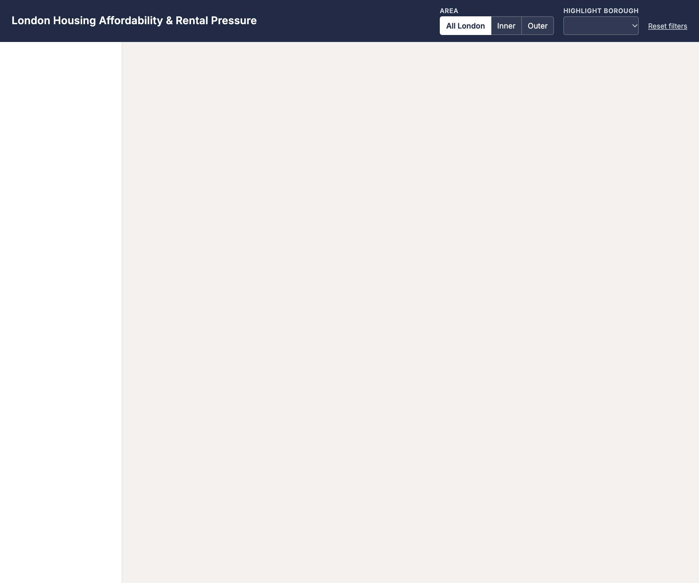 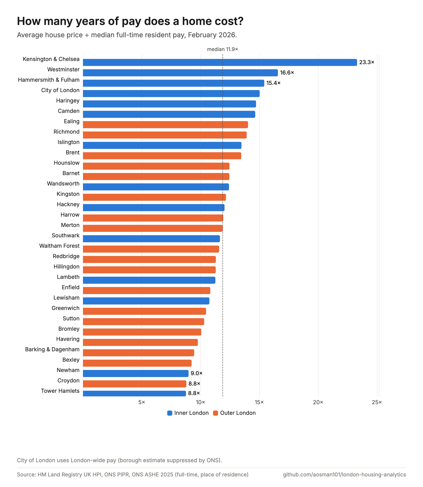

**2. A 10% deposit takes between 10.5 and 28 months of gross pay**, and that assumes you save
everything you earn. At a realistic 15% saving rate, that is 6 to 16 years.

**3. Rent takes 39–83% of median full-time pay, and every borough is above the 30% benchmark.**
The median is 52%. Inner London is the most stretched (60% vs 46% in Outer London).

**4. Rents are outpacing pay in 18 of 32 boroughs**, most sharply in outer east London: Bexley
(+9.7pp), Barking & Dagenham (+8.6pp). Since 2015, rents have grown faster than house prices
in every borough with rent data: a median of +47.5% against +31.7% for prices. Outer London
rents rose most (Barking & Dagenham +75%, Havering +70%, Bexley +70%).

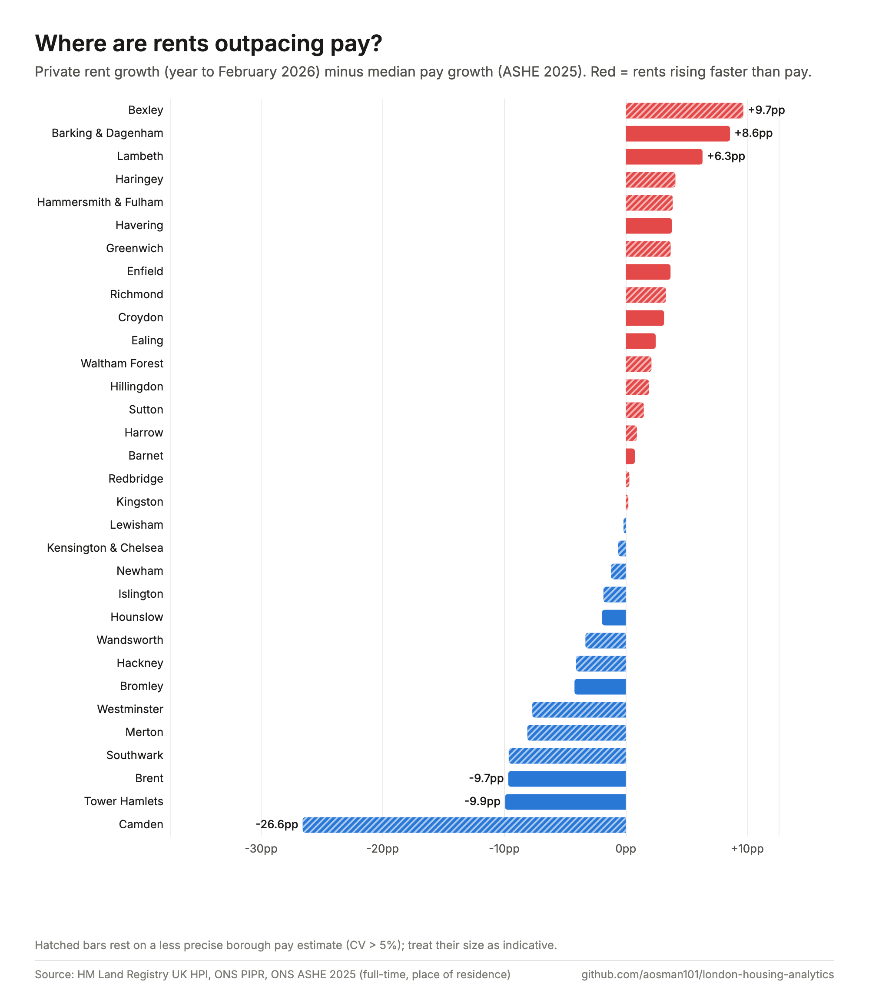 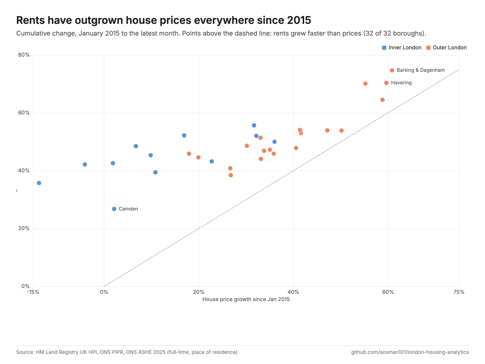

**5. Rent inflation peaked around the turn of 2025 and is cooling.** It peaked at 10.7% in
Outer London (Oct 2024) and 11.2% in Inner London (Jan 2025), and is now 4.1% and 1.8%,
against London pay growth of 3.6%.

**6. London is trading at less than half its peak volume.** There were 77,988 sales in 2025,
against 173,993 in 2002, and every borough is 23–50% below its 2021 stamp-duty-holiday level.
Sales volumes lead prices: the same-year correlation is weak (r = 0.17), but sales change
against the *next* year's price change gives r = 0.53.

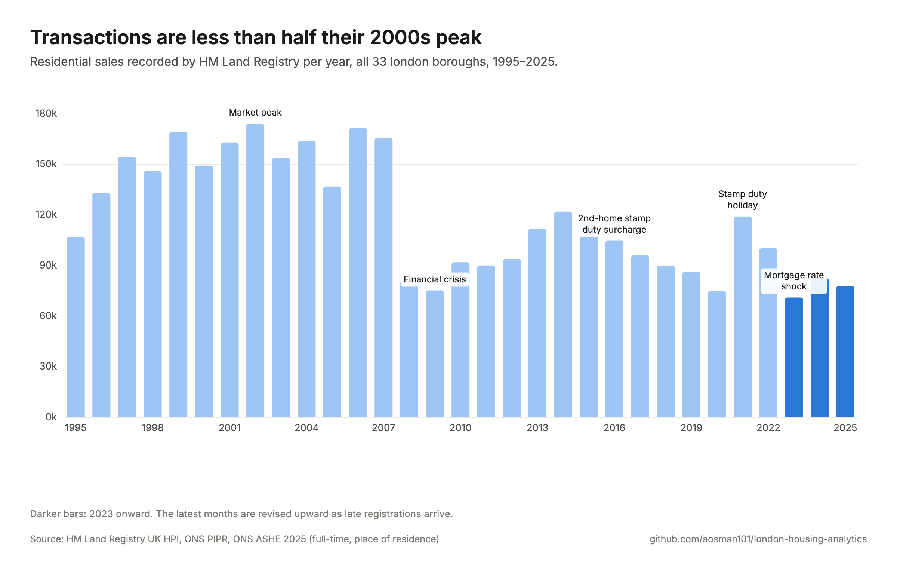 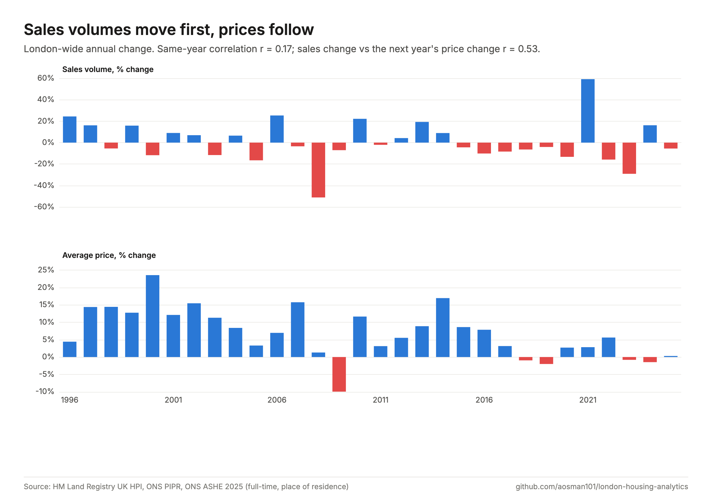

**7. Prime central London prices are still falling in cash terms.** Nine boroughs are more than 10% below
their all-time-high average price: the City (−31.7%), Westminster (−28.8%) and Kensington &
Chelsea (−26.0%). Inner London prices grew 0.9% a year over 2015–2025, against 2.8% in Outer
London.

**8. Property type is as big a driver as postcode.** The median flat costs 8.4x local pay, a
terraced house 13.3x, a semi 17.2x and a detached house 26.7x. A detached house in
Kensington & Chelsea is 83.5x local pay. Flats are under 10x pay in 25 of 33 boroughs.

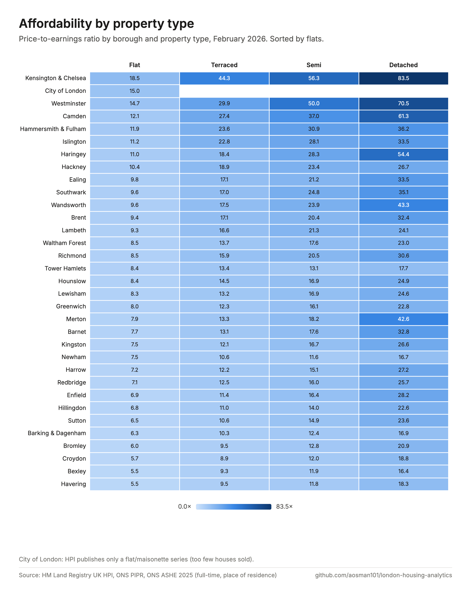 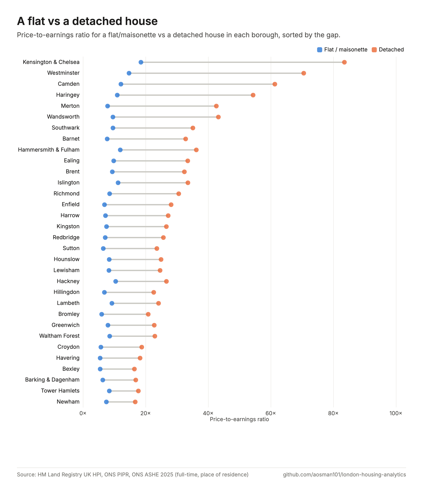

**9. Cheaper boroughs pay landlords higher yields** (r = −0.44 between yield and price): Tower
Hamlets 6.3% and Newham 6.0%, against Richmond 3.4% and Kensington & Chelsea 3.5%.

**10. The composite housing stress index** combines price-to-earnings, rent-to-earnings and
5-year rent growth. It ranks Kensington & Chelsea, Hounslow and Westminster as most
stressed, and Bromley, Newham and Croydon as least.

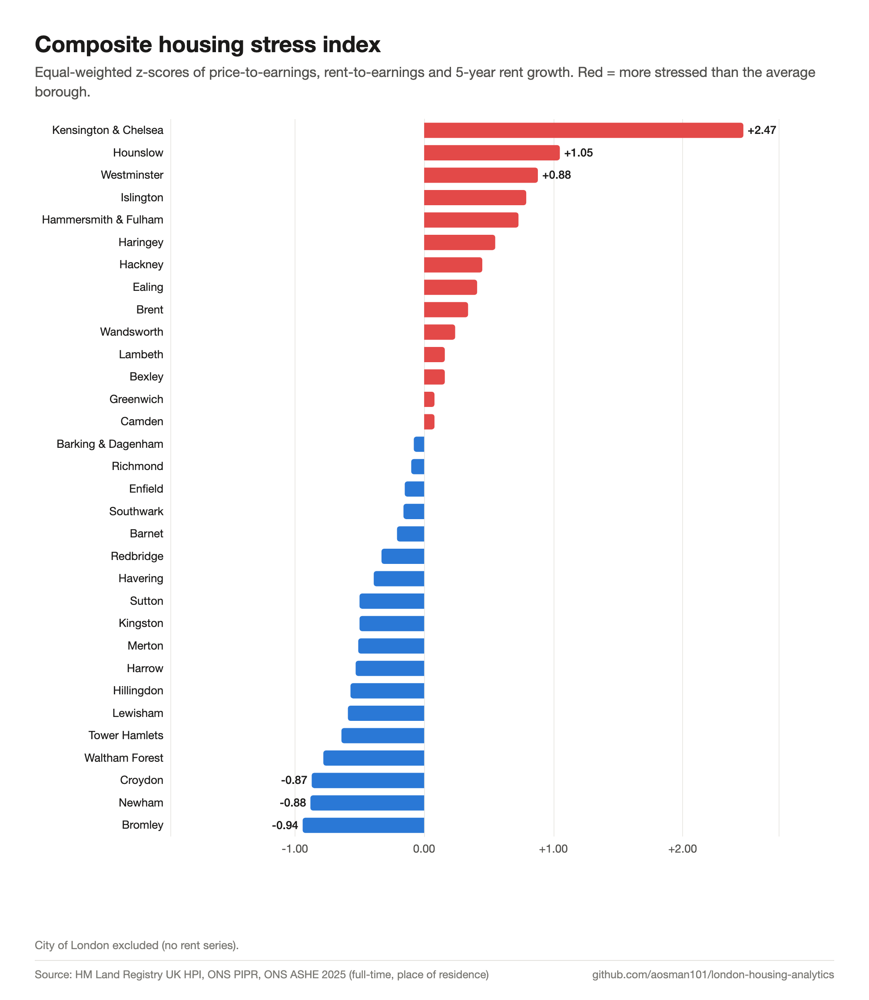 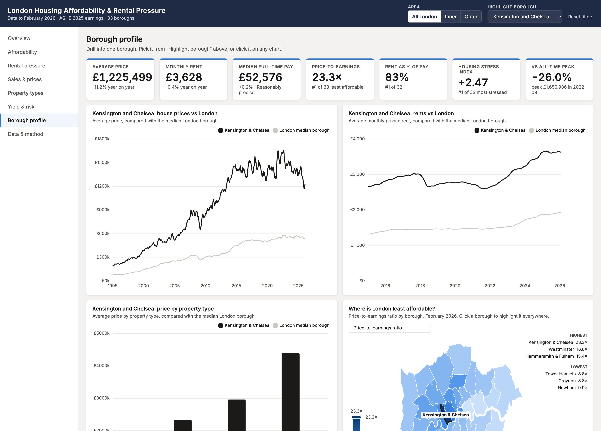

## Method

- **Earnings:** ASHE 2025 (provisional) median gross annual pay for full-time employees, by
  place of residence. Earnings are only attached to 2025–26 months, so historical prices are
  never divided by present-day pay (the same rule the dbt marts enforce).
- **City of London:** ONS suppresses its pay estimate (sample too small), so the London-wide
  figure is used. PIPR publishes no City rent series, and HPI publishes only a flat price there.
- **Precision:** the ASHE coefficient of variation is mapped to ONS precision bands. Hatched
  bars mark less precise borough pay estimates (CV > 5%), such as Camden's +19.1%, which drives its
  −26.6pp rental-pressure reading.
- **Inner/Outer London** follows the ONS statistical definition (14 inner, 19 outer authorities).
- **Stress index:** the equal-weighted mean of z-scores. It is a ranking device, not a forecast.
- **Gross yield:** average rent ÷ average price across the whole stock. It is indicative,
  before costs, voids and tax.
- **HPI:** borough prices are 3-month moving averages. Recent sales counts are revised upward
  as late registrations arrive. All prices are nominal.

| Dataset | Rows | Boroughs | Coverage |
| --- | --- | --- | --- |
| HPI average prices | 12,342 | 33 | Jan 1995 – Feb 2026 |
| HPI sales volumes | 12,276 | 33 | Jan 1995 – Dec 2025 |
| HPI prices by property type | 49,368 | 33 | Jan 1995 – Feb 2026 |
| PIPR private rents | 4,320 | 32 | Jan 2015 – Mar 2026 |
| ASHE earnings | 33 | 32 + London | 2025 |

## Image index

| # | File | # | File |
| --- | --- | --- | --- |
| 00 | Full dashboard | 11 | Sales lead prices |
| 01 | Map: price-to-earnings | 12 | Sales 2025 vs 2021 |
| 02 | Price-to-earnings ranking | 13 | Drawdown from peak |
| 03 | Housing stress index | 14 | Property-type heatmap |
| 04 | Months to save a deposit | 15 | Flat vs detached gap |
| 05 | Rent as % of pay | 16 | Property-type medians |
| 06 | Rents vs pay growth | 17 | Gross rental yield |
| 07 | Rent vs price growth since 2015 | 18 | Yield vs price |
| 08 | Rent inflation trend | 19 | Price volatility |
| 09 | House price trend 1995–2026 | 20–22 | Interactive app pages |
| 10 | Sales volume history | | |

Contains HM Land Registry data © Crown copyright and database right 2026. Contains ONS data
licensed under the Open Government Licence v3.0. Charts use [Apache ECharts](https://echarts.apache.org)
5.5.1 (Apache-2.0, vendored in `dashboard/vendor/`).
